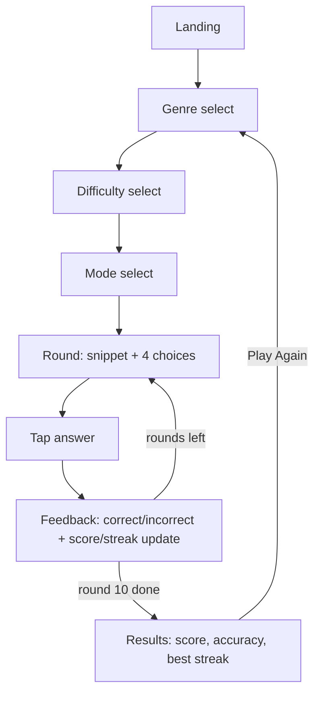

# LyricGuess — User Flow

## Screens
1. **Landing** — title + Play. Zero friction, no signup.
2. **Genre select** — 5 tappable options.
3. **Difficulty select** — Easy / Medium / Hard.
4. **Mode select** — Guess the Song / Guess the Artist.
5. **Round** — snippet + 4 choices + score/streak/progress. (Repeats ×10.)
6. **Answer feedback** — inline on the round screen: correct/incorrect, score +
   streak update, then next round.
7. **Results** — final score, accuracy %, best streak, Play Again.

## Flow diagram

## Edge branches
- **Insufficient songs for combo** — caught after mode select, before Round 1:
  message + nudge back to genre/difficulty. Never enters a broken session.
- **Question won't load** — inline on Round: short message + Retry.
- **Connection drops** — non-blocking banner + Retry; session state preserved.
- **Session expired** — message + Start New Game (back to Landing/Genre).

## Flow principles
- Setup is a straight line: Landing → Genre → Difficulty → Mode → Round. No
  branching, no back-tracking required to play.
- Play Again loops back to Genre select (not Landing) — one fewer tap to replay,
  supports the replay-rate goal.
- Every error branch rejoins the main flow or offers a clean restart.
